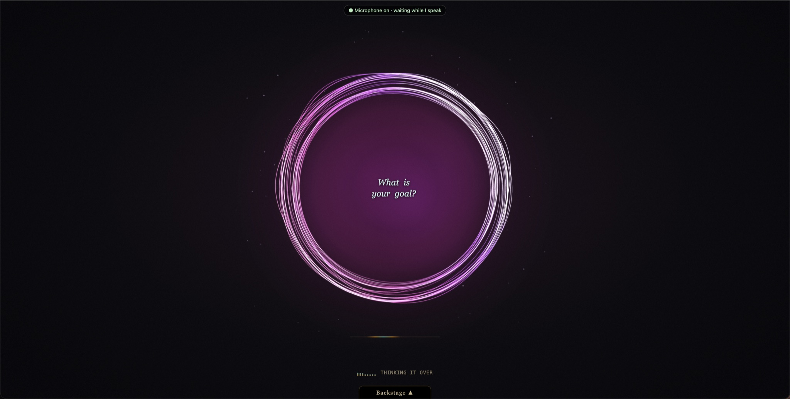
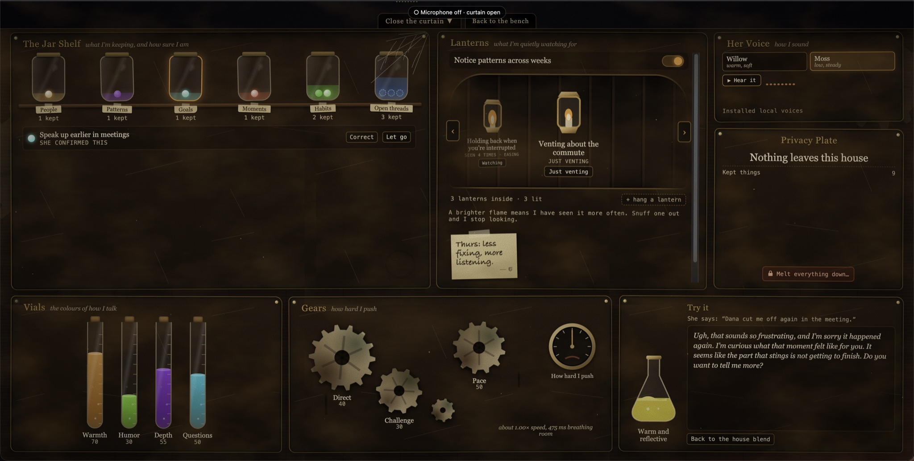

# Hearth — local, offline voice companion (release candidate)

Hearth is an experimental, voice-first companion that runs on one Apple-silicon Mac. Speech recognition, language-model inference, speech synthesis, memory and the interface stay on that computer while Hearth is running. There is no cloud fallback or telemetry path in the application.

Hearth is **not therapy, a clinician, a medical device or an emergency service**. It never contacts emergency services, family or anyone else. The safety policy has not had clinical review. This repository remains a release candidate and `/healthz` deliberately reports `personal_use_ready: false`; do not use it for sensitive personal conversations yet.

Exact build history is recorded in `PATCHES.md` and `.hearth-build.json`. The current build is `1.3.0-rc1+p007`. See `RELEASE_READINESS.md` for the evidence chart and unfinished work.

## Screenshots





## Run

On the fully local M3 laptop, double-click `Launch-Hearth-Testbed.command`. See `docs/LOCAL_LAPTOP.md`. The manual synthetic-only path remains:

```sh
python3 -m venv .venv
.venv/bin/python -m pip install -r requirements.txt
export HEARTH_DEV_PASSWORD='choose-a-synthetic-development-password'
export HEARTH_COOKIE_SECURE=0
.venv/bin/python run_dev.py
```

Open `http://127.0.0.1:4173`.

The one-click launcher needs a prepared local model environment. It does not download models, call a hosted API or make a second Mac part of the system. Setup details and current limitations are in `docs/LOCAL_LAPTOP.md`.

For the synthetic dev tray and side-by-side orb lab, also set `HEARTH_DEV_TOOLS=1`, then open `http://127.0.0.1:4173/dev/orb`. Dev endpoints return 404 when that flag is disabled.

## Verify

```sh
.venv-ai/bin/python -m pip install -r requirements-test.txt
.venv-ai/bin/python -m unittest discover -v
/Applications/ChatGPT.app/Contents/Resources/cua_node/bin/node --test tests/*.test.mjs
HEARTH_BROWSER='/Applications/Brave Browser.app/Contents/MacOS/Brave Browser' .venv-ai/bin/python tests/voice_browser_check.py
```

The Python suite covers authentication, CSRF, throttling, shelf redaction, melt state, background execution, deletion proof, SQLite permissions, host validation, offline assets and production/dev separation. The JavaScript suites cover the renderer registry, seven long-form synthetic replays, measured geometry, determinism, reduced motion, fallback/disposal, audio conversion and the realtime event bridge. The browser runs use Brave: the main acceptance covers desktop and 360 px shell flows; the 18-check voice run uses only a synthetic microphone and fake local engines.

## Orb and U2 shell structure

- `dist/orb/registry.js` — contract-aware registry and selection.
- `dist/orb/controller.js` — guarded calls, quality downgrade and fallback.
- `dist/orb/fallback-ring.js` — built-in safe renderer.
- `dist/orb/filament-v1.js` — deterministic renderer using `host.rng`.
- `dist/orb/bootstrap.js` — shell integration.
- `dist/orb/active-renderer.json` — runtime renderer selection; changing this swaps a compatible orb without rebuilding the shell.
- `dev_ui/synthetic-replays.json` — seven synthetic fixtures.
- `dev_ui/orb.html` — dev-only comparison lab.
- `tests/orb_contract.test.mjs` — U1 contract checks.
- `dist/shell/realtime.js` — validated version-1 event protocol.
- `dist/shell/mock-event-server.js` — deterministic U2 transport and mic acknowledgements.
- `dist/shell/bootstrap.js` — front-of-house event wiring.
- `OrbInstallprocedure.MD` — isolated renderer installation, verification and rollback guide.
- `dist/shell/audio-bands.js` — real Web Audio FFT-to-eight-band adapter; production does not simulate speech bands when no source is attached.
- `RELEASE_READINESS.md` — exact V1 deployment gates and evidence still required.

The UI uses system font stacks only. No font files are bundled or fetched.

## Public-project boundaries

- Tests use synthetic data. Never paste real conversations, credentials, model weights or the contents of `runtime/` into an issue or commit.
- Model files are not part of this repository. Their upstream licenses apply separately.
- Hearth is released under the MIT License. You may use, modify and redistribute it as long as the copyright and license notice remain with the software.
- Security problems should be reported without personal data. See `SECURITY.md`.

## License and credit

Copyright © 2026 [erikerikerik](https://github.com/erikerikerik). Released under the [MIT License](LICENSE).

Create a production-style hash with `.venv/bin/python scripts/create_password_hash.py`. Production setup must use `HEARTH_PASSWORD_HASH`, secure cookies and the reviewed local HTTPS boundary.
